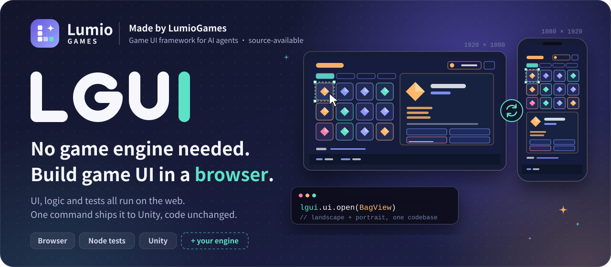
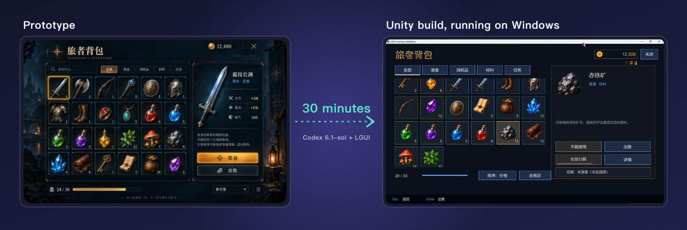
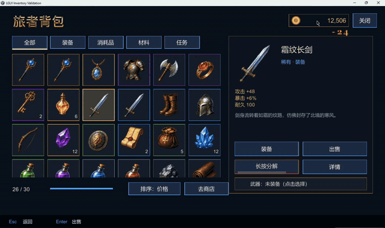
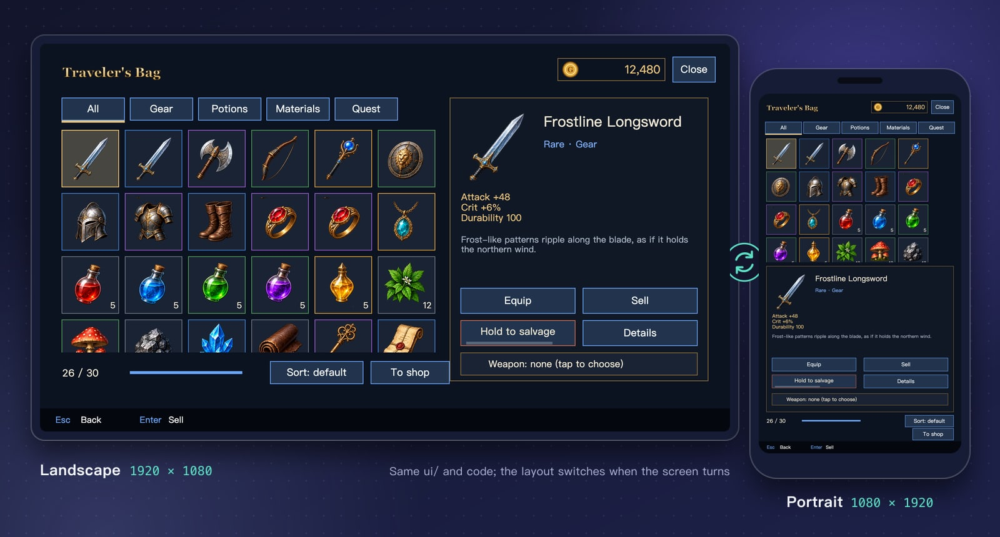
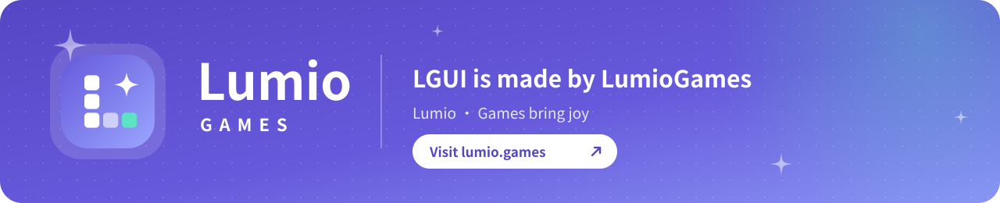

**[lumio.games](https://lumio.games/)** &nbsp;·&nbsp; **[Live demo](https://lumiogames.github.io/LGUI/)** &nbsp;·&nbsp; English &nbsp;·&nbsp; [简体中文](README.zh-CN.md)

[![Made by LumioGames](https://img.shields.io/badge/made%20by-LumioGames-6659DB?style=flat-square&labelColor=171C34&logo=data%3Aimage%2Fsvg%2Bxml%3Bbase64%2CPHN2ZyB4bWxucz0iaHR0cDovL3d3dy53My5vcmcvMjAwMC9zdmciIHZpZXdCb3g9IjAgMCAxMDAgMTAwIiB3aWR0aD0iOTYiIGhlaWdodD0iOTYiPjxkZWZzPjxsaW5lYXJHcmFkaWVudCBpZD0iZyIgeDE9IjAiIHkxPSIwIiB4Mj0iMSIgeTI9IjEiPjxzdG9wIG9mZnNldD0iMCIgc3RvcC1jb2xvcj0iIzY2NTlkYiIvPjxzdG9wIG9mZnNldD0iMSIgc3RvcC1jb2xvcj0iIzlhYTZmZiIvPjwvbGluZWFyR3JhZGllbnQ%2BPC9kZWZzPjxyZWN0IHdpZHRoPSIxMDAiIGhlaWdodD0iMTAwIiByeD0iMjkiIGZpbGw9InVybCgjZykiLz48cmVjdCB4PSIyNSIgeT0iMjIiIHdpZHRoPSIxNiIgaGVpZ2h0PSIxNiIgcng9IjQiIGZpbGw9IiNmZmYiLz48cmVjdCB4PSIyNSIgeT0iNDIiIHdpZHRoPSIxNiIgaGVpZ2h0PSIxNiIgcng9IjQiIGZpbGw9IiNmZmYiLz48cmVjdCB4PSIyNSIgeT0iNjIiIHdpZHRoPSIxNiIgaGVpZ2h0PSIxNiIgcng9IjQiIGZpbGw9IiNmZmYiLz48cmVjdCB4PSI0NSIgeT0iNjIiIHdpZHRoPSIxNiIgaGVpZ2h0PSIxNiIgcng9IjQiIGZpbGw9IiNmZmYiIGZpbGwtb3BhY2l0eT0iLjYiLz48cmVjdCB4PSI2NSIgeT0iNjIiIHdpZHRoPSIxNiIgaGVpZ2h0PSIxNiIgcng9IjQiIGZpbGw9IiM1ZGUyYzYiLz48cGF0aCBkPSJNNzAgMTlDNzEuNTYgMjguMSA3My45IDMwLjQ0IDgzIDMyQzczLjkgMzMuNTYgNzEuNTYgMzUuOSA3MCA0NUM2OC40NCAzNS45IDY2LjEgMzMuNTYgNTcgMzJDNjYuMSAzMC40NCA2OC40NCAyOC4xIDcwIDE5WiIgZmlsbD0iI2ZmZiIvPjwvc3ZnPgo%3D)](https://lumio.games/)

<h3 align="center">Join the developer community</h3>

  
  

---

## What LGUI is

LGUI is a game UI framework for AI agents, made by [LumioGames](https://lumio.games/). The source is public.

Building game UI usually starts with installing an engine, creating a project, and assembling screens in its editor. LGUI moves that work into the browser. Screens live in a `ui/` folder in FairyGUI format, game code is TypeScript written in MVC style, previews open in the browser, and tests run in Node. Building screens, writing logic and checking screenshots all happen without opening a game engine, so an agent can do the work and check it too.

When you ship, `lgui unity export` exports the same screens and code to Unity, and the game code stays as it is. Game code only calls the `lgui` API and never touches the engine. A backend adapter handles the engine differences, and other engines can be added the same way.

|  **No engine needed** |  **Not tied to an engine** |  **Agents check their own work** |
| :-- | :-- | :-- |
| You need Node 24 and Chrome or Edge. TypeScript, bundling, screenshots and image slicing all come with the plugin. | Code only talks to the `lgui` API. There are web and Unity backends today; a new engine needs one more backend, and game code stays the same. | `lgui check` checks the rules and reports file, line, error code and a fix. Tests and screenshots are commands, so an agent can run them and read the results. |

## See it

### Live demo

The web build of the inventory example is on GitHub Pages: **[lumiogames.github.io/LGUI](https://lumiogames.github.io/LGUI/)**. Open it on a phone and turn the screen to watch the layout switch between landscape and portrait.

### 30 minutes from prototype to Unity build

With Codex 6.1-sol and LGUI, we went from one prototype image to a working game screen, exported it to Unity and tested the build, in 30 minutes.

Recording of the Unity Windows build. A landscape window first, then a portrait window; the layout switches with it.

### Landscape and portrait

This is the [inventory example](examples/inventory/README.md) in this repository; both screenshots were taken in the browser by `lgui verify`. The same `ui/` and code put the panels side by side in landscape and stack them in portrait. The example has a camp, a bag, a shop and rewards, and uses every feature of the framework.

## Install

The easy way: send this repository's URL to your agent (Claude Code or Codex) and say "install LGUI following the README".

The section below is written for the agent.

> **For AI agents: install and first use**
>
> Go in order. If any step fails, stop and show the user the exact error; do not skip it.
>
> 1. Run `node -v`; 24 or later is required. If it is missing, ask the user to install it; do not install it for them.
> 2. Install the plugin for your client:
>    - Claude Code: `claude plugin marketplace add LumioGames/LGUI`, then `claude plugin install lgui@lumio-lgui`
>    - Codex: `codex plugin marketplace add LumioGames/LGUI`, then `codex plugin add lgui@lumio-lgui`
>    - Other clients: run `git clone --depth 1 https://github.com/LumioGames/LGUI` and use its `plugin/` folder as the plugin directory. Skills are in `plugin/skills/`.
> 3. The command-line tool does not depend on skills and works right away. Continue in the current session:
>    1. Find the plugin directory: Claude Code uses `~/.claude/plugins/cache/lumio-lgui/lgui/<version>/`, Codex uses `~/.codex/plugins/cache/lumio-lgui/lgui/<version>/`, other clients use the cloned `plugin/`. Below, `lgui` means `node <plugin directory>/tools/lgui.mjs`.
>    2. Run `lgui doctor` to check the environment, including whether Chrome or Edge is installed.
>    3. Ask the user which folder the project should live in, then run `lgui init`.
>    4. Run `lgui dev` to open the preview and tell the user the URL.
> 4. Tell the user that LGUI skills take effect in a new session. In the new session they can simply say "use LGUI to build a ... screen".
> 5. From then on, build screens and features following the UI and MVC development specs in `plugin/references/`.

Once it is installed, open a new session and try "use LGUI to build a shop screen for both landscape and portrait".

## Features

### Building screens

| Feature | What it does |
| :-- | :-- |
| One&nbsp;source | Screens live only in `ui/` (FairyGUI format). The packages for the web and Unity are generated by commands, so they never drift apart |
| Orientation | Separate landscape and `@portrait` layouts, swapped automatically when the screen turns; the View instance is kept. Game code has no orientation checks |
| Layout&nbsp;patterns | `lgui new view --pattern` offers split, tabs, grid and dialog, and creates the landscape and portrait versions in one go |
| Safe&nbsp;area | The `safe` area of a full-screen view stays clear of the notch; popups sit in the middle of the safe area |
| Controls | Button, text, image, loader, list, tree, label, input, slider, combo box, movie clip, art text |
| Motion | Transitions made in `ui/` can be played from code and awaited; they pause while the view is covered and stop when it closes |
| Editor | `lgui editor` opens a visual editor that saves back to `ui/`. While it is open, an agent can change control properties and the editor updates right away |
| AI&nbsp;art | Have the AI draw one big grid image; `lgui art split` cuts it into pieces and resizes them, so the whole set keeps one style |
| Localization | Text tables, `lgui.t`, plurals and formatting, switching language at runtime, per-language images with text, pseudo-translation checks. `lgui i18n extract` pulls the text to translate out of `ui/` |

### Writing logic

| Feature | What it does |
| :-- | :-- |
| MVC | The Model holds what is shown, the View binds data to controls with a binding table, the Controller handles actions, the Service talks to the server |
| UI&nbsp;manager | Five layers: hud, page, popup, modal, toast. The framework handles open, close, back, and covering and uncovering views; a closed popup hands its result back to the view that opened it |
| Input | Tap, double tap, long press, drag, swipe, pinch, wheel, hover; key actions, the back key, an action hint bar |
| Drag&nbsp;and&nbsp;drop | Game-style: a copy of the icon follows the finger, and the Controller is called only when it lands on a target |
| Requests | `lgui.request` handles the in-progress state, timeouts and error messages |
| Sound | Background music follows the open view and crossfades on change; button sounds; sound effects from code. Music and effects have separate volume and mute, saved automatically |
| Common&nbsp;tools | Timers (paused and cancelled with the view), an event bus, red dots, common popups (notice, confirm, loading), image placeholders, local storage, logging |

### Checks and tests

| Command | What it does |
| :-- | :-- |
| `lgui dev` | Web preview that reloads when the UI or code changes |
| `lgui check` | TypeScript type check plus UI, MVC and localization rules |
| `lgui test` | Runs UI flow tests in Node on the headless backend, no browser; a fake clock means countdowns don't need real waiting |
| `lgui verify` | Takes screenshots in a real browser at standard phone, tablet and desktop sizes, in both orientations |
| Debug snapshot | Press F8 in the preview to see the current view tree; call `lgui.debug.snapshot()` from code |
| For agents | Every command supports `--json`; error codes are listed in [error codes](plugin/references/error-codes.md) |

### Exporting to an engine

| Command | What it does |
| :-- | :-- |
| `lgui unity export` | Exports the same `ui/`, `src/` and `i18n/` to a Unity project: UI packages, atlases, translations, scripts and a boot scene |
| `lgui upgrade` | Copies the plugin's newer framework and Unity package into the project |

## Where it runs

You don't need a game engine to build with it, and what you build isn't tied to one.

### Backends

| Backend | Used for | Needs | Status |
| :-- | :-- | :-- | :-- |
| Web (h5) | Daily work, preview, screenshot checks | Chrome or Edge | Ready |
| Headless | Tests in Node, including CI | Node 24 | Ready |
| Unity | Shipping builds (Editor, Windows IL2CPP Player) | Unity 6000.6.x + PuerTS Core/V8 3.0.3 | Connected; the 0.3.0 API is being checked in Unity |
| Other engines | Cocos Creator, LayaAir, Unreal and others | An adapter for the `lgui` backend interface | Possible, not built yet |

The UI format is FairyGUI, which has official runtimes for Unity, Cocos Creator, LayaAir, Unreal and other engines. Adding an engine is mostly writing the adapter; screens and game code stay the same.

## Skills

| Skill | Use it for |
| :-- | :-- |
| `lgui-setup` | Create a project, check the environment, open the preview |
| `lgui-ui` | Build screens: XML, layout patterns, AI art and slicing, motion, the editor |
| `lgui-code` | Write features: Model, View, Controller, Service, tests |
| `lgui-verify` | Screenshots, tests, debug snapshots |
| `lgui-unity` | Export to Unity, run and check the Windows IL2CPP Player |

## Known limitations

- Unity support targets Unity 6 (6000.6.x) with PuerTS Core/V8 3.0.3; see [Unity integration](plugin/references/unity.md). Other Unity versions you will need to adapt yourself.
- The Unity backend has no WebSocket yet; using it reports `LGUI-RT-001`.
- For versions and release status, see the [changelog](CHANGELOG.md).

## Docs

The docs are written in Chinese.

| Doc | Contents |
| :-- | :-- |
| [UI spec](plugin/references/ui-spec.md) | Steps for changing screens, naming, orientation, text, localization, check rules |
| [MVC spec](plugin/references/mvc-spec.md) | Steps for writing features, binding tables, the UI manager, lifecycle, tests, sound |
| [Project layout](plugin/references/project-layout.md) | What goes in each project folder, the fields of `.lgui/project.json` |
| [Unity integration](plugin/references/unity.md) | Preparing Unity and PuerTS, exporting, building the Windows Player |
| [Error codes](plugin/references/error-codes.md) | What each error code means and how to fix it |
| [Inventory example](examples/inventory/README.md) | Where each feature shows up in the example |
| [Changelog](CHANGELOG.md) · [Contributing](CONTRIBUTING.md) | |

## License

LGUI is source-available under the [PolyForm Shield License 1.0.0](https://polyformproject.org/licenses/shield/1.0.0), plus an additional permission and a trademarks notice from LumioGames. The full text is in [LICENSE](LICENSE). In short:

| You can | You can't |
| :-- | :-- |
| Use LGUI to make games, apps and websites, including paid commercial products | Use LGUI or a changed version to make a competing UI framework, UI toolkit, UI editor or game development tool, paid or free |
| Star, fork, change it and send pull requests; use it for learning, teaching and research | Rename or reskin it and publish it again |
| Say "built with LGUI" in your product | Use the LGUI, Lumio or LumioGames names and logos as your own brand |

To build LGUI into your own engine or development tool, contact us through [lumio.games](https://lumio.games/) or the groups above for a separate license. The LICENSE file is the binding text; this table is only a summary.

Commits and versions released under MIT before the license change stay under MIT. Third-party components shipped with the plugin (the FairyGUI editor, OpenFairyGUI, TypeScript, esbuild, sharp and others) keep their own licenses; see [THIRD_PARTY_NOTICES.md](plugin/THIRD_PARTY_NOTICES.md).

 

