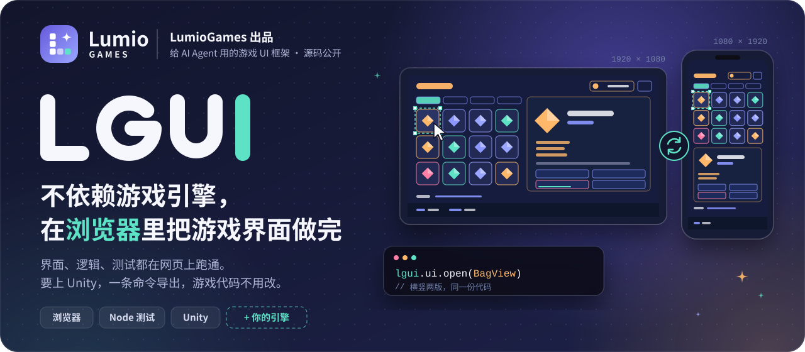
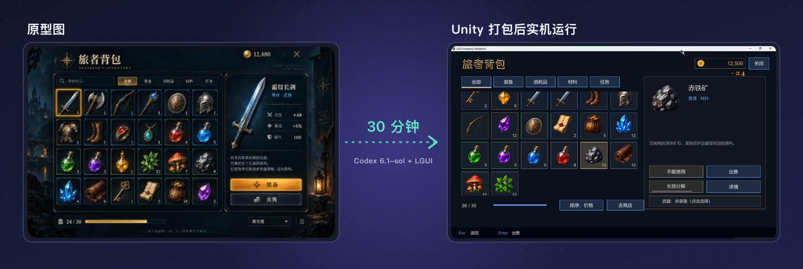
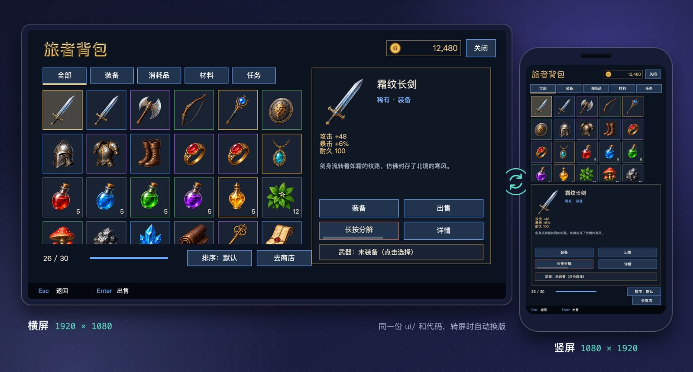
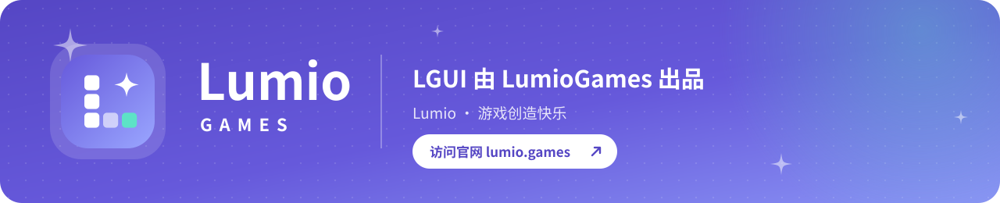

**[官网 lumio.games](https://lumio.games/)** &nbsp;·&nbsp; **[在线试玩](https://lumiogames.github.io/LGUI/)** &nbsp;·&nbsp; [English](README.md) &nbsp;·&nbsp; 简体中文

[![LumioGames 出品](https://img.shields.io/badge/LumioGames-%E5%87%BA%E5%93%81-6659DB?style=flat-square&labelColor=171C34&logo=data%3Aimage%2Fsvg%2Bxml%3Bbase64%2CPHN2ZyB4bWxucz0iaHR0cDovL3d3dy53My5vcmcvMjAwMC9zdmciIHZpZXdCb3g9IjAgMCAxMDAgMTAwIiB3aWR0aD0iOTYiIGhlaWdodD0iOTYiPjxkZWZzPjxsaW5lYXJHcmFkaWVudCBpZD0iZyIgeDE9IjAiIHkxPSIwIiB4Mj0iMSIgeTI9IjEiPjxzdG9wIG9mZnNldD0iMCIgc3RvcC1jb2xvcj0iIzY2NTlkYiIvPjxzdG9wIG9mZnNldD0iMSIgc3RvcC1jb2xvcj0iIzlhYTZmZiIvPjwvbGluZWFyR3JhZGllbnQ%2BPC9kZWZzPjxyZWN0IHdpZHRoPSIxMDAiIGhlaWdodD0iMTAwIiByeD0iMjkiIGZpbGw9InVybCgjZykiLz48cmVjdCB4PSIyNSIgeT0iMjIiIHdpZHRoPSIxNiIgaGVpZ2h0PSIxNiIgcng9IjQiIGZpbGw9IiNmZmYiLz48cmVjdCB4PSIyNSIgeT0iNDIiIHdpZHRoPSIxNiIgaGVpZ2h0PSIxNiIgcng9IjQiIGZpbGw9IiNmZmYiLz48cmVjdCB4PSIyNSIgeT0iNjIiIHdpZHRoPSIxNiIgaGVpZ2h0PSIxNiIgcng9IjQiIGZpbGw9IiNmZmYiLz48cmVjdCB4PSI0NSIgeT0iNjIiIHdpZHRoPSIxNiIgaGVpZ2h0PSIxNiIgcng9IjQiIGZpbGw9IiNmZmYiIGZpbGwtb3BhY2l0eT0iLjYiLz48cmVjdCB4PSI2NSIgeT0iNjIiIHdpZHRoPSIxNiIgaGVpZ2h0PSIxNiIgcng9IjQiIGZpbGw9IiM1ZGUyYzYiLz48cGF0aCBkPSJNNzAgMTlDNzEuNTYgMjguMSA3My45IDMwLjQ0IDgzIDMyQzczLjkgMzMuNTYgNzEuNTYgMzUuOSA3MCA0NUM2OC40NCAzNS45IDY2LjEgMzMuNTYgNTcgMzJDNjYuMSAzMC40NCA2OC40NCAyOC4xIDcwIDE5WiIgZmlsbD0iI2ZmZiIvPjwvc3ZnPgo%3D)](https://lumio.games/)

<h3 align="center">加入开发者社群</h3>

  
  

---

## LGUI 是什么

LGUI 是 [LumioGames](https://lumio.games/) 出品的游戏 UI 框架，给 AI Agent 用，源码公开。

做游戏界面，一般要先装引擎、建工程，再在编辑器里一个个拼。LGUI 把这件事搬进了浏览器：界面用 FairyGUI 格式放在 `ui/` 文件夹里，游戏代码用 TypeScript 按 MVC 写，预览开浏览器，测试在 Node 里跑。拼界面、写逻辑、截图验收，全程不用打开游戏引擎，Agent 自己做、自己验。

要上线的时候，`lgui unity export` 把同一份界面和代码导出到 Unity，游戏代码不用改。游戏代码只调用 `lgui` 的接口，不直接碰引擎，引擎之间的差别由后端适配层处理。接别的引擎也是这个办法。

|  **不依赖引擎** |  **不绑引擎** |  **Agent 能自己验收** |
| :-- | :-- | :-- |
| 电脑上只要 Node 24 和 Chrome / Edge。TypeScript、打包、截图、拆图这些工具都跟着插件装好了。 | 代码只认 `lgui` 接口。现在有网页和 Unity 两个后端，换引擎写一个后端，游戏代码不动。 | 规范都能用 `lgui check` 查，报错带文件、行号、错误码和改法。测试、截图都是命令，Agent 跑完自己看结果。 |

## 效果

### 在线试玩

背包示例的网页版放在 GitHub Pages 上，点开就能玩：**[lumiogames.github.io/LGUI](https://lumiogames.github.io/LGUI/)**。手机上打开转一下屏，能看到界面在横版和竖版之间切换。

### 30 分钟：从原型图到 Unity 包

用 Codex 6.1-sol 加 LGUI，从一张原型图开始，做出游戏界面，再导出到 Unity 打包测试，一共 30 分钟。

Unity 打出来的 Windows 包，实机录屏：前半段是横屏窗口，后半段换成竖窗口，界面跟着换版

### 横竖屏

上图是仓库里的[背包示例](examples/inventory/README.md)，两张截图都是 `lgui verify` 在浏览器里截的。同一份 `ui/` 和代码，横屏是左右分栏，竖屏自动换成上下堆叠。示例里有营地、背包、商店、领奖四块，框架的每项功能都用到了。

## 安装

最省事的办法：把这个仓库的地址发给你的 Agent（Claude Code、Codex 都行），说一句「照 README 把 LGUI 装好」。

下面这段是写给 Agent 看的。

> **给 AI Agent：安装与第一次使用**
>
> 按顺序做。任何一步失败都停下，把错误原文告诉用户，不要跳过。
>
> 1. 运行 `node -v`，要求 24 或更高。没有就请用户自己装，不要替用户装。
> 2. 按你所在的客户端安装插件：
>    - Claude Code：`claude plugin marketplace add LumioGames/LGUI`，然后 `claude plugin install lgui@lumio-lgui`
>    - Codex：`codex plugin marketplace add LumioGames/LGUI`，然后 `codex plugin add lgui@lumio-lgui`
>    - 其他客户端：`git clone --depth 1 https://github.com/LumioGames/LGUI`，把里面的 `plugin/` 当插件目录，技能在 `plugin/skills/`。
> 3. 命令行不依赖技能，装完就能用。在当前会话里接着做：
>    1. 找到插件目录：Claude Code 在 `~/.claude/plugins/cache/lumio-lgui/lgui/<版本>/`，Codex 在 `~/.codex/plugins/cache/lumio-lgui/lgui/<版本>/`，其他客户端就是克隆下来的 `plugin/`。下面的 `lgui` 都指 `node <插件目录>/tools/lgui.mjs`。
>    2. 运行 `lgui doctor` 检查环境，包括电脑上有没有 Chrome 或 Edge。
>    3. 问用户工程放在哪个文件夹，然后运行 `lgui init` 建工程。
>    4. 运行 `lgui dev` 打开预览，把网址告诉用户。
> 4. 告诉用户：LGUI 的技能要新开一个会话才生效。新会话里直接说「用 LGUI 做一个某某界面」就行。
> 5. 之后做界面、写功能，都按 `plugin/references/` 里的 UI 开发规范和 MVC 开发规范来。

装好以后，新开一个会话，试试「用 LGUI 做一个商店界面，横竖屏都要」。

## 功能

### 做界面

| 功能 | 说明 |
| :-- | :-- |
| 一⁠个⁠界⁠面⁠源 | 界面只放在 `ui/`（FairyGUI 格式）。网页和 Unity 用的界面包都由命令生成，不会出现两份对不上 |
| 横⁠竖⁠屏 | 横版和 `@portrait` 竖版两套布局，转屏时自动换，View 实例保留。游戏代码里不写横竖屏判断 |
| 排⁠布⁠模⁠板 | `lgui new view --pattern` 有分栏、标签页、网格、弹窗四种，一次生成横竖两版 |
| 安⁠全⁠区 | 全屏界面里的 `safe` 区域自动避开刘海，弹窗放在安全区正中 |
| 控⁠件 | 按钮、文字、图片、装载器、列表、树、标签、输入框、滑动条、下拉框、序列帧动画、美术字 |
| 动⁠效 | `ui/` 里做好的动效，代码里能播放、等它播完；界面被盖住时暂停，关掉时停 |
| 编⁠辑⁠器 | `lgui editor` 打开可视化编辑器，存回 `ui/`。编辑器开着时 Agent 也能改控件属性，画面马上变 |
| AI ⁠出⁠图 | 让 AI 一次画一整张网格大图，`lgui art split` 拆成小图并缩放到要的尺寸，整套风格一致 |
| 多⁠语⁠言 | 文本表、`lgui.t`、复数和格式化、运行中换语言、带字图片按语言换、伪翻译检查。`lgui i18n extract` 从 `ui/` 提取要翻译的字 |

### 写逻辑

| 功能 | 说明 |
| :-- | :-- |
| MVC | Model 放要显示的数据，View 用绑定表把数据接到控件上，Controller 处理操作，Service 连服务器 |
| 界⁠面⁠管⁠理 | hud、page、popup、modal、toast 五层。打开、关闭、返回、被盖住再露出来都由框架管；弹窗关闭时把结果交回给打开它的界面 |
| 输⁠入 | 点击、双击、长按、拖拽、滑动、双指缩放、滚轮、悬停；按键动作、返回键、操作提示栏 |
| 拖⁠放 | 游戏里那种拖放：拖起来有跟手的图标，放到目标上才调用 Controller |
| 请⁠求 | `lgui.request` 管「请求中」、超时和失败提示 |
| 声⁠音 | 背景音乐跟着界面切换，换曲淡入淡出；按钮音；代码里放音效。音乐和音效分开调音量、静音，设置自动保存 |
| 常⁠用⁠工⁠具 | 定时器（跟着界面暂停和取消）、广播站、红点、通用弹窗（提示、确认、加载中）、图片占位、本地存储、日志 |

### 检查和测试

| 命令 | 说明 |
| :-- | :-- |
| `lgui dev` | 网页预览，改了界面或代码自动刷新 |
| `lgui check` | TypeScript 类型检查，加上 UI、MVC、多语言规范检查 |
| `lgui test` | 用 headless 后端在 Node 里跑界面流程测试，不开浏览器；用假时钟，倒计时不用真等 |
| `lgui verify` | 在真浏览器里按手机、平板、电脑的标准尺寸，横竖两个方向各截一张 |
| 调试快照 | 预览里按 F8 看当前界面树，代码里用 `lgui.debug.snapshot()` |
| 给 Agent 读 | 所有命令都支持 `--json`；错误码统一编号，见[错误码](plugin/references/error-codes.md) |

### 导出到引擎

| 命令 | 说明 |
| :-- | :-- |
| `lgui unity export` | 把同一份 `ui/`、`src/`、`i18n/` 导出到 Unity 工程：界面包、图集、翻译、脚本和启动场景 |
| `lgui upgrade` | 把插件里的新版框架和 Unity 包同步进工程 |

## 跑在哪

做的时候不需要任何游戏引擎，做完了也不绑定任何引擎。

### 运行后端

| 后端 | 用来干什么 | 需要什么 | 状态 |
| :-- | :-- | :-- | :-- |
| 网页（h5） | 日常开发、预览、截图验收 | Chrome 或 Edge | 可用 |
| headless | 在 Node 里跑测试，也能放进 CI | Node 24 | 可用 |
| Unity | 出包上线（Editor、Windows IL2CPP Player） | Unity 6000.6.x + PuerTS Core/V8 3.0.3 | 已接入，0.3.0 新接口在 Unity 里验收中 |
| 其他引擎 | Cocos Creator、LayaAir、Unreal 等 | 按 `lgui` 的后端接口写一个适配层 | 可以接，还没做 |

界面格式用的是 FairyGUI，它在 Unity、Cocos Creator、LayaAir、Unreal 等引擎上都有官方运行库。所以接新引擎主要是写适配层，界面和游戏代码都不用动。

## 技能

| 技能 | 什么时候用 |
| :-- | :-- |
| `lgui-setup` | 建工程、检查环境、打开预览 |
| `lgui-ui` | 拼界面：XML、排布模式、出图拆图、动效、编辑器 |
| `lgui-code` | 写功能：Model、View、Controller、Service、测试 |
| `lgui-verify` | 截图、测试、调试快照 |
| `lgui-unity` | 导出到 Unity，运行和验证 Windows IL2CPP Player |

## 已知限制

- Unity 目前适配的是 Unity 6（6000.6.x）加 PuerTS Core/V8 3.0.3，步骤见[接入 Unity](plugin/references/unity.md)。其他 Unity 版本需要自己适配。
- Unity 后端还没有 WebSocket，用到时会报 `LGUI-RT-001`。
- 版本和发布情况见[更新记录](CHANGELOG.md)。

## 文档

| 文档 | 内容 |
| :-- | :-- |
| [UI 开发规范](plugin/references/ui-spec.md) | 改界面的固定步骤、命名、横竖屏、文字、多语言、检查规则 |
| [MVC 开发规范](plugin/references/mvc-spec.md) | 写功能的固定步骤、绑定表、界面管理、生命周期、测试、声音 |
| [用户工程目录](plugin/references/project-layout.md) | 工程里每个文件夹放什么，`.lgui/project.json` 的字段 |
| [接入 Unity](plugin/references/unity.md) | 准备 Unity 和 PuerTS、导出、打 Windows Player |
| [错误码](plugin/references/error-codes.md) | 每个错误码是什么意思、怎么改 |
| [背包示例](examples/inventory/README.md) | 每项功能在示例里的哪个位置 |
| [更新记录](CHANGELOG.md) · [参与开发](CONTRIBUTING.md) | |

## 许可

LGUI 源码公开，采用 [PolyForm Shield 1.0.0](https://polyformproject.org/licenses/shield/1.0.0) 许可，另加 LumioGames 的附加许可和商标说明，全文都在 [LICENSE](LICENSE) 里。简单说：

| 可以 | 不可以 |
| :-- | :-- |
| 用 LGUI 做游戏、应用、网站，包括收费的商业产品 | 拿 LGUI 或改过的版本去做 UI 框架、UI 工具、UI 编辑器、游戏开发工具这类竞品，收费、免费都不行 |
| star、fork、修改、提 PR，用来学习、教学、研究 | 换个名字、换层皮重新发布 |
| 在你的产品里写「用 LGUI 制作」 | 把 LGUI、Lumio、LumioGames 的名字和图标当成自己的品牌 |

想把 LGUI 集成进你自己的引擎或开发工具，请先通过[官网](https://lumio.games/)或上面的社群联系我们，单独授权。以 LICENSE 里的英文原文为准，这里的中文只是帮助理解。

换协议之前已经按 MIT 发布的提交和版本，仍按 MIT。随插件分发的第三方组件（FairyGUI 编辑器、OpenFairyGUI、TypeScript、esbuild、sharp 等）按各自的许可，见 [THIRD_PARTY_NOTICES.md](plugin/THIRD_PARTY_NOTICES.md)。

 

